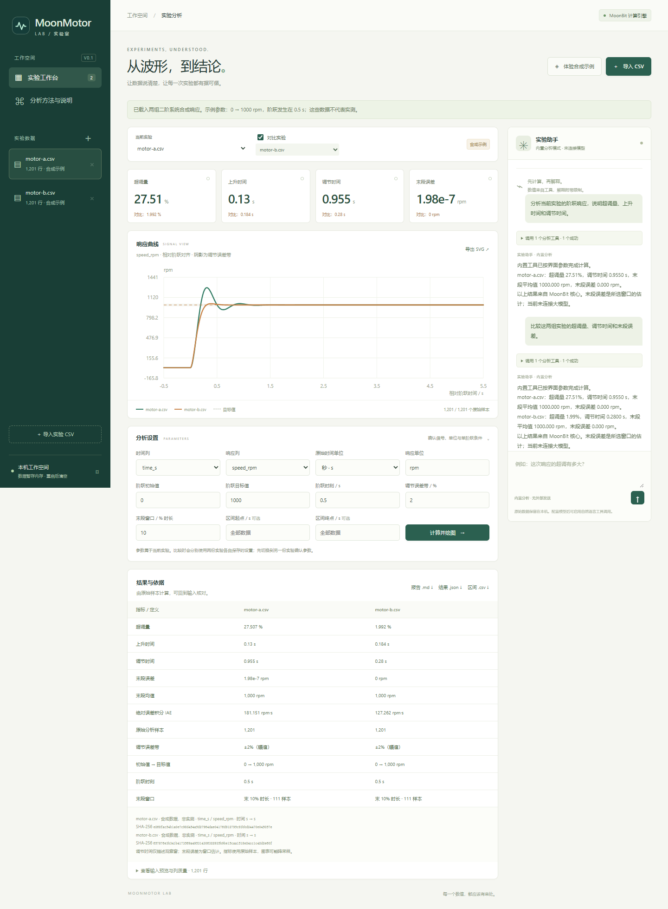

# MoonData Lab

> **范围调整中：** 用户要求通用数据应用，之前的电机专用定位已撤销。以下 V0.1 功能与截图属于历史原型，不能代表通用数据生成/分析已经实现。当前计划见 [通用版实施计划](docs/PLAN.md) 与 [范围纠正](docs/SCOPE_CORRECTION.md)。

**用自然语言探索电机实验数据，让曲线、指标与结论都有依据。**

MoonData Lab 是一个本机运行的中文实验工作台。上传 CSV、确认信号和单阶跃条件，然后计算响应指标、比较两次实验、向助手提问，并导出可核对的报告。

MoonBit 负责 CSV 解析和数学计算；Node.js 负责本机服务及模型工具调用；浏览器负责交互和 SVG 曲线。运行时没有第三方 JavaScript 包依赖。Playwright 只用于开发验收。



## 当前功能

- CSV 导入、拖放、列质量概览、输入预览与 UTF-8 内容 SHA-256。
- 显式选择时间列、响应列、原始时间单位、响应单位、初始值、目标值和阶跃时刻。
- 单实验与双实验响应曲线，支持秒、毫秒、微秒到秒的转换和时间区间选择。
- MoonBit 计算超调量、10–90% 上升时间、观察窗内调节时间、末段均值/误差、IAE、均值、总体标准差和 RMS。
- 图表显示降采样保留各桶极值；指标仍使用全部原始分析样本。
- 内置离线分析，以及兼容工具调用协议的真实模型连接；可展开调用记录核对。
- Markdown 报告、JSON 结果、SVG 图表、原始分析区间 CSV 导出。
- 合成示例、桌面和手机布局、模型请求取消、错误提示和旧结果失效。

**边界：** 本版没有 CAN 实时采集、FFT、参数辨识或神经网络训练。数据暂存进程内存，服务重启后清空；浏览器刷新后保留当前会话数据，但分析参数需重新确认。模型文字解释不构成稳定性证明或故障诊断。

## 快速开始

需要 Node.js 22+ 和 MoonBit 工具链。当前在 Node.js 24.19.0、moonc 0.10.15 上验证。MoonBit 安装见[官方说明](https://www.moonbitlang.com/download)。

```sh
node scripts/build.mjs
node server/index.mjs
```

浏览器打开 <http://127.0.0.1:4321>，点击“体验合成示例”即可比较两组电机响应。

如果 MoonBit 没有加入 PATH，Windows PowerShell 可以指定：

```powershell
$env:MOON = '你的工具链目录\bin\moon.exe'
node scripts/build.mjs
node server/index.mjs
```

也可以将工具链可执行文件的完整路径写入忽略的 `.local/moon-path.txt`。项目不捆绑工具链、不修改其他项目和全局设置。

### 使用自己的数据

```csv
time_ms,speed_rpm
0,0
100,200
200,600
300,1000
400,1010
500,1000
```

1. 导入 UTF-8、逗号分隔、带表头的 CSV。
2. 确认时间列与响应列；原始时间单位应选毫秒。
3. 填入真实的初始值、目标值、阶跃时刻；时刻和区间设置始终以秒为单位。
4. 点击“计算并绘图”，或向实验助手提问。
5. 比较两次实验时，先分别切换并确认各自参数，再勾选“对比实验”。

空值、NaN、无穷大不会补零。时间必须严格递增，重复时间不自动合并。每份 CSV 上限 10 MiB、100000 数据行和 128 列；会话上限 12 份数据、100 万单元格及 20 MiB 文件内容。

## 连接真实模型

默认是**内置分析模式**：只运行已有分析工具，不调用模型，不向外发送数据。内置模式是受限的快捷操作，不宣称能理解任意自然语言。

模型服务需要支持 `chat/completions`、`tools` 和 `tool_calls`。在服务端设置环境变量后重启：

```powershell
$env:LAB_MODEL_URL = 'https://你的模型服务地址/v1'
$env:LAB_MODEL_NAME = '你的模型名称'
# 如果服务要求密钥，在自己的终端中设置 LAB_MODEL_KEY。
# 不要将密钥写进源码、浏览器或发给别人。
node server/index.mjs
```

`LAB_MODEL_URL` 是 API 基础地址，程序会追加 `/chat/completions`。远程服务必须使用 HTTPS；本机服务可用 HTTP。不支持的模型协议不会被悄悄替换成内置模式。

每次提问会发送：当前问题、最近有限条对话、所选实验文件名与参数，以及工具返回的列描述、统计摘要和计算结果。**不发送原始 CSV 或原始数据行。** 名称和列名也可能敏感，使用远程服务前应确认自己有权发送这些信息。

Agent 只提供三个工具：

| 工具 | 行为 |
| --- | --- |
| `inspect_experiments` | 查看当前选择的实验描述、列质量和摘要 |
| `analyze_experiment` | 用界面确认的参数计算一份实验 |
| `compare_experiments` | 比较当前选择的两份实验 |

模型不能改写分析条件、读取任意路径、运行命令或执行生成代码。单次最多 6 轮模型响应、10 次工具调用、120 秒总时限，单轮请求最多 45 秒。模型没有调用计算工具时，界面会明确标注该回答未执行数据分析。

**验证状态：** 已通过本地 HTTP 协议桩和真实浏览器工具调用验收；尚未使用外部模型凭据做实测，不能据此宣称兼容全部模型服务。

## 开发与验证

核心、接口和 Agent 测试不需要安装 JavaScript 依赖：

```sh
node scripts/check.mjs
node scripts/benchmark.mjs
```

完整检查会更新 MoonBit 公共接口、格式化源码，执行 JS 与 Wasm GC 测试，构建 JS 引擎并测试服务。查看 `artifacts/verification.json`。

浏览器验收需要安装锁定的开发依赖：

```sh
pnpm install --frozen-lockfile --ignore-scripts
pnpm exec playwright install chromium
node scripts/browser-test.mjs
```

Windows 已有 Edge 时可以跳过下载浏览器：

```powershell
$env:BROWSER_CHANNEL = 'msedge'
node scripts/browser-test.mjs
```

浏览器脚本自行启动临时本机服务和模型协议桩，结束后关闭；不会使用你的模型凭据。验证报告为 `artifacts/browser-verification.json`，截图只包含合成数据。

## 项目结构与文档

```text
csv/          MoonBit 严格 CSV 与数值列解析
analysis/     MoonBit 统计和单阶跃响应
api/          JSON / JS 导出边界
server/       数据会话、工具、Agent、报告和本机 HTTP
web/          中文工作台、SVG 绘图
examples/     确定性合成数据
scripts/      构建、检查、示例、浏览器与性能测量
test/         服务、数学互操作、Agent 协议测试
docs/         计划、计算契约、架构、验收与迭代记录
```

- [详细实施计划](docs/PLAN.md)
- [计算方法与边界](docs/METHODS.md)
- [架构与接口](docs/ARCHITECTURE.md)
- [验收状态](docs/ACCEPTANCE.md)
- [迭代记录](docs/WORKLOG.md)
- [参考项目与来源说明](THIRD_PARTY.md)

## 许可

Apache-2.0，见 [LICENSE](LICENSE)。这是独立实现，当前不依赖 MoonFrame、MoonCharts 或 Data Formulator 的代码，不宣称与这些项目兼容或获得其背书。
