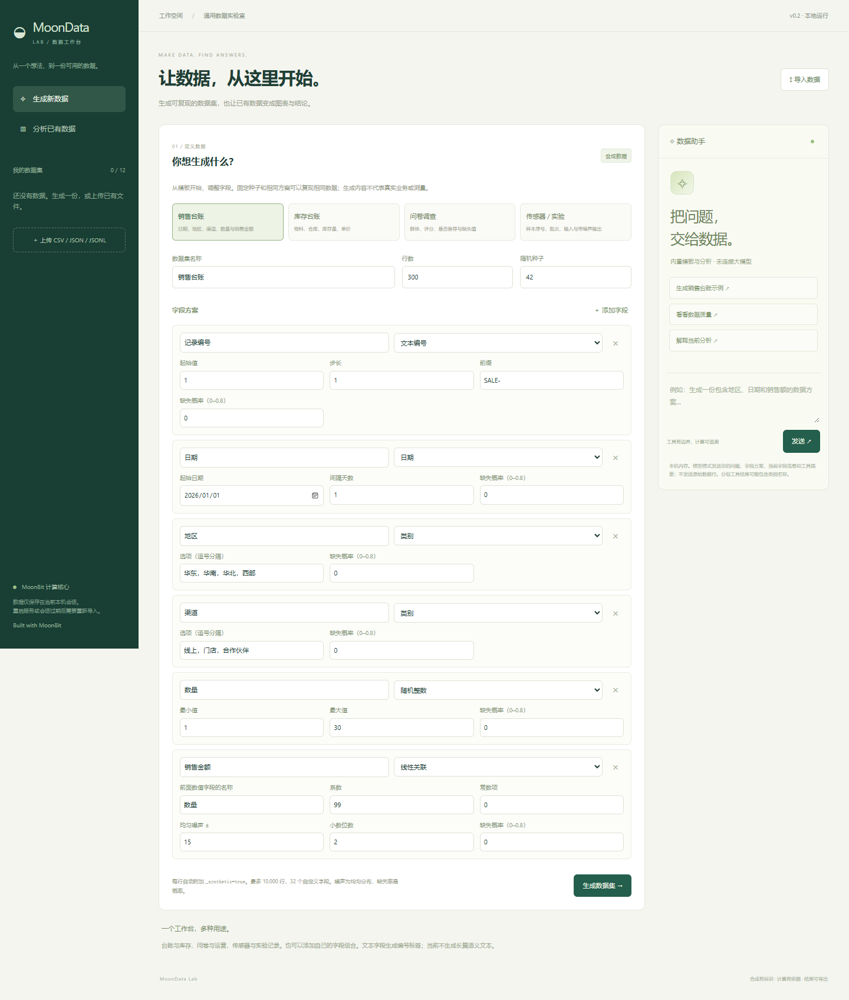
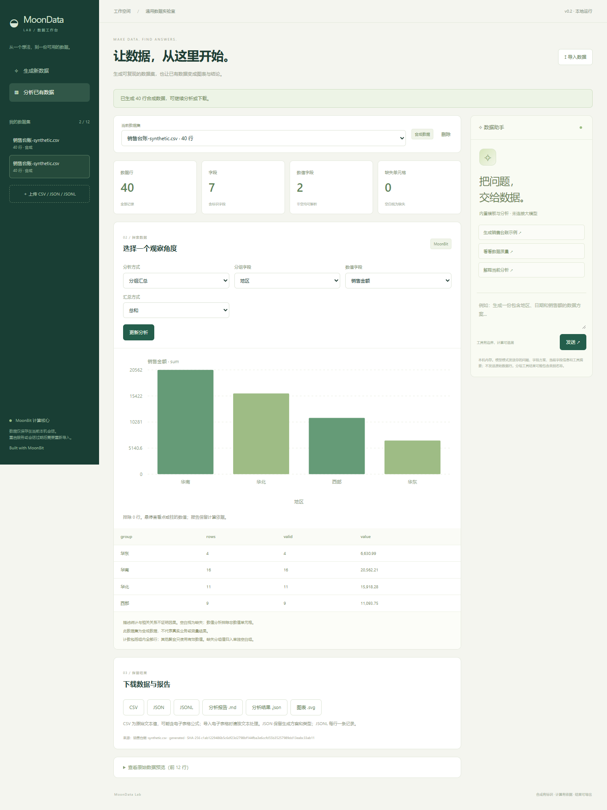

# MoonData Lab

**生成可复现的数据集；上传已有数据，生成图表、分析与报告。**

本机运行的中文通用数据工作台。销售台账、库存、问卷、运营、传感器和实验记录都可以使用，不要求电机参数、时间列或行业专属格式。



## 当前可以做什么

- **生成数据**：可编辑字段、行数和随机种子；支持文本编号、数值序列、随机整数/小数、类别、布尔、日期、带噪声线性关联，以及按概率制造缺失值。固定方案和种子复现相同 CSV 指纹。
- **分析数据**：导入 CSV、扁平对象 JSON / JSONL，查看类型、数值摘要、缺失、不同值数量、原始预览；按类别计数、求和、平均、最小/最大；查看直方图、四分位数、折线、散点和 Pearson 相关系数。
- **保留结果**：下载完整 CSV / JSON / JSONL、Markdown 报告、JSON 分析结果和 SVG 图表。报告从当前查询重新计算，附来源 SHA-256、排除行数、参数和方法局限。
- **数据助手**：默认离线模板与确定性工具；配置支持工具调用的模型后，可以用自然语言提出生成方案或调用分析。生成方案先展示给用户检查，再点击生成。

所有新生成记录自动附加 `_synthetic=true`，文件名和界面也标为合成数据。合成数据不代表真实业务、调查或测量。导入数据的真实性未经验证，导入的合成标识也是来源文件声明。



## 快速开始

需要 Node.js 22+ 和 MoonBit 工具链（本机验证：Node 24.19.0、MoonBit 0.10.15）。

```sh
node scripts/build.mjs
node server/index.mjs
```

打开 `http://127.0.0.1:4321`。默认展示销售台账方案，可直接点“生成数据集”；也可以点“导入数据”。无需先安装 npm 包：运行时没有第三方 JS 依赖。

MoonBit 不在 PATH 时：

```powershell
$env:MOON = '你的工具链目录\bin\moon.exe'
node scripts/build.mjs
```

也可以把完整可执行路径写入忽略的 `.local/moon-path.txt`。服务读取进程环境，**不会自动加载 `.env` 文件**。

### 上传数据

CSV 为 UTF-8、逗号分隔、带表头；支持引号、逗号、多行、BOM 和 Unicode。JSON 为扁平对象数组，或本项目导出的 `{records:[...]}`；JSONL 每个非空行是一条扁平对象。值支持文本、有限数值、布尔和 null，暂不支持嵌套对象或数组。

```csv
地区,金额,数量
华东,100,2
华南,150,3
华东,200,4
```

导入后选择“分组汇总”→地区→总和→金额，华东结果为 300，华南为 150。不需要时间、目标值或专业条件。CSV 的 ID 等字段下载为 JSON 时保持文本值，以免丢失前导零；分析时另外解析数值。

### 连接模型

默认模式不访问外部模型，也不假装能理解自由自然语言。可用表单完成全部生成和分析；内置助手只识别界面建议中的明确命令。

支持 `chat/completions` 的 `tools` / `tool_calls` 协议。服务端设置：

```powershell
$env:LAB_MODEL_URL = 'https://你的模型服务地址/v1'
$env:LAB_MODEL_NAME = '你的模型名称'
# 如果需要密钥，在自己的终端中设置 LAB_MODEL_KEY，不要写进源码。
node server/index.mjs
```

程序在基础地址后追加 `/chat/completions`。远程地址须 HTTPS，本机可用 HTTP。不支持的协议会报错，不会悄悄回退到模板模式。顶部“模型已连接配置”表示配置存在，实际请求时才验证连接。

| 工具 | 功能 |
| --- | --- |
| `propose_generation` | 验证并展示合成数据字段方案；不创建数据 |
| `profile_dataset` | 当前选择的数据集结构、类型和统计摘要 |
| `explore_dataset` | 受限的概览、分组、分布、散点或折线 |

模型只收到问题、有限对话、字段方案、当前字段信息和精简工具结果。**不发送原始数据行或绘图采样点**；分组结果会包含类别名称。没有任意代码、命令、网络搜索或文件工具。单次最多 6 轮、10 次调用、120 秒，单轮 45 秒。可点击“停止”。

目前通过了模拟模型服务的协议与浏览器验证；**尚未实测外部模型服务**，模型解释仍需核对。

## 限制

- 生成最多 10,000 行、32 自定义字段、300,000 单元格（含标识）。导入每文件最多 10 MiB、100,000 行、128 列。
- 每会话最多 12 个数据集、100 万单元格、20 MiB 文件内容；本机最多 8 会话，空闲两小时可回收。
- 数据在内存中；刷新保留同一 Cookie 会话的数据，但分析方式重置；重启服务会清空。需要保留时下载文件。
- 第一版面向结构化表格。尚未提供 XLSX、PDF、图片、长文本语料生成、隐私合成保证、训练/预测、任意表达式、表关联或跨数据集自动比较。
- 生成的噪声和数值均为所选分布的模拟。相关不证明因果；总体标准差不是样本标准差；缺失值不补零。
- CSV 保留原始文本，含公式样式的文本请在电子表格中按文本导入。JSON / JSONL 适合类型明确的交换。
- 专业阶跃代码只作为历史回归模块保留，不出现在默认界面；方法见 `docs/archive/MOTOR_V0_METHODS.md`。

## 开发与验证

```sh
node scripts/check.mjs
node scripts/generate-examples.mjs
node scripts/benchmark.mjs
```

完整检查会更新 MoonBit 接口和格式，运行 JS / WasmGC 核心与 Node 测试。浏览器验收：

```sh
pnpm install --frozen-lockfile --ignore-scripts
pnpm exec playwright install chromium
node scripts/browser-test.mjs
```

Windows 已安装 Edge 可先设置 `$env:BROWSER_CHANNEL='msedge'`，跳过浏览器下载。测试自行启动并关闭服务，模型测试用模拟服务，不需要密钥。

最新验收见 [ACCEPTANCE](docs/ACCEPTANCE.md)，详细步骤与后续范围见 [PLAN](docs/PLAN.md)，数学约定见 [METHODS](docs/METHODS.md)，接口见 [ARCHITECTURE](docs/ARCHITECTURE.md)。

```text
csv/        MoonBit 严格 CSV 解析与数值列
generator/  MoonBit 随机数、约束与合成行生成
explore/    MoonBit 聚合、分箱、分位数与相关
analysis/   MoonBit 统计与历史专业模块
api/        JSON / JavaScript 导出
server/     数据格式、会话、受限工具和本机 HTTP
web/        中文界面、交互与 SVG
examples/   标注清楚的合成示例及历史回归数据
test/       数学互操作、服务和 Agent 协议
docs/       计划、计算约定、架构与验收
```

## GitHub

用户已授权推送；当前环境尚无 GitHub CLI 登录。登录后运行 `node scripts/publish-github.mjs`，默认创建私有 `FidollarinLA/moondata-lab`，推送 `codex/initial-workbench` 并核对远端 SHA；不强推、不改全局 Git 设置。远端 CI 未运行时不报告发布完成。

Apache-2.0，见 [LICENSE](LICENSE)。项目为独立实现，参考来源见 [THIRD_PARTY](THIRD_PARTY.md)，不声称移植或兼容整个 Data Formulator。
